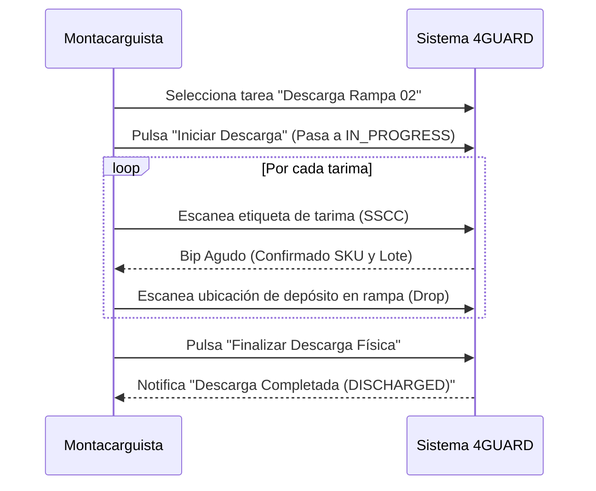

# Manual de Usuario Oficial: Montacarguista / Operador RF
**Sistema:** 4GUARD WMS  
**Perfil Asignado:** `ROLE_WAREHOUSE_OPERATOR` / `FORKLIFT_OPERATOR`  
**Entorno de Uso Principal:** Terminal RF PWA (`rf-terminal` / Cockpit Industrial) y Consulta Web Básica (`/inventory-query`)  
**Versión del Manual:** 2.0  

---

## 1. Introducción a la Terminal RF Industrial 4GUARD

La **Terminal RF de 4GUARD** es una aplicación web progresiva (PWA) de grado industrial diseñada específicamente para operar en tablets montadas en montacargas (cabina) o lectores láser portátiles tipo pistola (pistolas Honeywell / Zebra).

### Características Diseñadas para Operación Ruda:
* **Ergonomía Visual**: Paleta cromática oscura de alto contraste para evitar reflejos de luz bajo techumbres industriales.
* **Botones Extragrandes**: Áreas de toque de 64px o mayores para operar con guantes industriales de protección.
* **Feedback Acústico y Háptico**: Tono agudo y vibración corta para lecturas correctas; tono grave prolongado para advertencia de error.
* **Operación en Tiempo Real**: Recepción instantánea de órdenes asignadas por Mesa de Control sin necesidad de refrescar la pantalla.

---

## 2. Inicio de Sesión Ergonómico (Código + PIN o Biometría Facial)

Al encender la terminal en el montacargas:

*Figura 1: Pantalla táctil de inicio de sesión con teclado numérico gigante y botón de Face ID.*

### Método A: Acceso por PIN Numérico
1. Seleccione su nombre o digite su código de operador (ej. `MC-03`).
2. En el teclado numérico en pantalla, digite su **PIN de 4 dígitos**.
3. Pulse el botón verde **`Entrar`**.

### Método B: Acceso por Biometría Facial (Face ID / WebAuthn)
1. Con la terminal orientada hacia su rostro, pulse el botón azul **`Autenticar con Face ID`**.
2. La cámara frontal validará sus rasgos faciales en menos de 1 segundo.
3. El sistema confirma la identidad sin que deba quitarse los guantes de carnaza.

---

## 3. El Cockpit de Trabajo del Montacarguista

Al ingresar, el montacarguista aterriza directamente en su **Cockpit de Misiones en Vivo**:

*Figura 2: Cola interactiva de misiones asignadas con distintivos de rampa y prioridad URGENTE.*

### Elementos del Cockpit:
* **Barra Superior**: Identificador de su código de operador (ej. *Operador: MC-03 - Carlos Ruiz*), sucursal y estado de conexión Wi-Fi de bodega.
* **Cola de Tareas Asignadas**: Lista secuenciada de órdenes enviadas por Mesa de Control:
  - 📥 **Descarga en Andén (Inbound Unload)**: Bajar pallets de un camión entrante.
  - 🔄 **Reubicación (Putaway / Traspaso)**: Mover tarimas desde la rampa hacia un rack.
  - 📤 **Carga para Despacho (Outbound Dispatch)**: Subir tarimas seleccionadas a un camión de salida.
* **Alarma de Prioridad URGENTE**: Si Mesa de Control activa prioridad urgente, la tarjeta de la tarea parpadea en color dorado, emite un sonido de campana y se coloca automáticamente al inicio de su lista.

---

## 4. Maniobra 1: Descarga Física en Andén (Inbound Unload)

1. En el Cockpit, seleccione la tarea de descarga (ej. *Recepción #REC-1049 - Rampa 02*).
2. Pulse el botón **`Tomar Tarea / Iniciar Maniobra`**. La orden pasa a estatus `IN_PROGRESS`.
3. Conduzca el montacargas hacia el andén indicado.
4. **Escaneo de Tarimas (Pick & Drop)**:
   - Levante la tarima con las cuchillas del montacargas.
   - Apunte el lector láser al código de barras de la tarima (código SSCC o etiqueta de proveedor).

*Figura 3: Interfaz de escaneo de tarima con validación visual inmediata y contador de pallets.*

   - La pantalla confirma en verde el producto y la cantidad.
   - Deposite la tarima en el área de buffer de la rampa y escanee el código de barras de la posición de rampa (ej. `LOC-RAMP-02`).
5. Repita el proceso con cada tarima del embarque.
6. Al bajar la última tarima de la caja del camión, pulse el botón verde gigante: **`Finalizar Descarga Física`**.
7. La orden cambia a **`DISCHARGED`**, informando a Mesa de Control que el camión está vacío y listo para revisión documental.

---

## 5. Maniobra 2: Cambio de Almacén y Reubicación (Putaway / Traspaso)

Para acomodar tarimas desde la rampa hacia las bahías de racks:

1. Seleccione la tarea de reubicación en su Cockpit.
2. La pantalla le mostrará la instrucción en formato claro:
   - **ORIGEN**: Bahía actual (ej. *Rampa 02 - Buffer*).
   - **DESTINO**: Bahía asignada (ej. *Nave A · Pasillo 03 · Nivel 02 · Bahía 14*).

*Figura 4: Navegación de ruta hacia la bahía destino y confirmación láser de posición.*

3. Diríjase a la bahía origen, levante la carga y escanee la tarima.
4. Conduzca hacia la bahía destino y **escanee el código de barras ubicado en el travesaño del rack**.
   > [!IMPORTANT]
   > **Candado de Seguridad Antierror de Posición**:  
   > Si usted escanea una bahía diferente a la asignada, la pantalla se teñirá de rojo, emitirá un zumbido grave y bloqueará la confirmación hasta que escanee la bahía correcta o Mesa de Control autorice un cambio de slot.
5. Al coincidir la bahía, pulse **`Confirmar Depósito`**. El sistema asienta la nueva ubicación en el inventario al instante.

---

## 6. Maniobra 3: Carga Física de Camión (Outbound Dispatch)

Para embarcar producto terminado para entrega a clientes:

1. Seleccione la orden de salida asignada (**`OUT-XXXXXX`**).
2. El sistema le presentará la lista ordenada de tarimas que debe retirar de los racks conforme al criterio de caducidad FEFO.

*Figura 5: Lista secuenciada de recolección en racks y estiba en caja de transporte.*

3. Acuda a cada rack indicado, escanee la tarima para confirmar que retira el lote correcto.
4. Traslade la carga al andén de embarque y estíbela en la caja del tráiler.
5. Al ingresar la última tarima solicitada en la orden, pulse **`Carga Física Completada`**.
6. La orden pasa a estado **`LOADED`**, avisando a Mesa de Control para que emita la Carta Porte y selle la salida del transporte.

---

## 7. Reporte de Daños y Pausas de Turno

*Figura 6: Modales ergonómicos de reporte de anomalía física y pausa operativa.*

### A. Reporte de Mercancía Dañada o Anomalía
Si al momento de levantar una tarima detecta cajas aplastadas, rotura de empaque, derrame de líquidos o tarima fracturada:
1. Pulse el botón amarillo de advertencia: **`Reportar Daño / Anomalía`**.
2. Seleccione el motivo en la lista rápida:
   - *Merma por tarima rota*.
   - *Empaque roto / Producto expuesto*.
   - *Humedad o derrame*.
   - *Etiqueta o lote ilegible*.
3. Pulse **`Confirmar Bloqueo Preventivo`**.
4. La tarima y su ubicación quedan bloqueadas automáticamente en el sistema (`BLOCKED`), evitando que nadie intente despacharla hasta que Calidad la dictamine.

### B. Pausas Operativas y Relevo de Turno
Si concluye su horario de turno, tiene hora de alimentos o el montacargas requiere carga de batería:
1. Pulse el botón **`Pausa Operativa`**.
2. Seleccione: *"Fin de Turno / Relevo de Cuadrilla"* o *"Alimentos / Receso"*.
3. El sistema guarda exactamente cuántas tarimas lleva descargadas o cargadas.
4. El siguiente montacarguista podrá ingresar con su propio código y continuar la maniobra exactamente donde usted la dejó, sin duplicar ni perder información.

---

## 8. Recomendaciones de Seguridad y Buenas Prácticas

1. **No opere la pantalla en movimiento**: Realice las confirmaciones y lecturas con el montacargas completamente detenido y con el freno de mano colocado.
2. **Conserve el ángulo de visibilidad**: Ajuste el soporte de la tablet para que no obstruya su campo visual de las cuchillas ni de los pasillos peatonales.
3. **Limpieza del lente**: Si el lector láser falla en leer un código de barras maltratado, limpie el lente con un paño seco; si persiste el daño en la etiqueta, use la función de captura manual de SSCC en pantalla.

